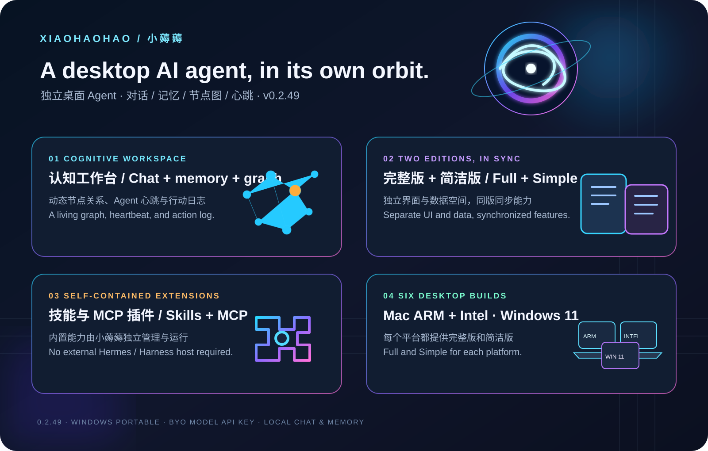

# 1 Billion Tokens? 1,000+ Hours? XiaoHaoHao 0.2.49 Lands in Six Desktop Builds


> **“1 billion tokens” and “1,000+ hours” are playful launch-copy hyperbole, not measured usage, billing, or work-hour records.** The factual release is XiaoHaoHao 0.2.49: macOS ARM64, macOS Intel x64, and Windows 11 x64, with both Full and Simple editions—six builds in total.

## An AI agent on your desktop

XiaoHaoHao is a standalone desktop AI agent. Its workspace brings chat, memory, a cognition graph, heartbeat activity, and action logs together. Full and Simple are separate interfaces and data spaces, while their bundled skills, plugins, and core capabilities ship in sync at the same version.



### What stands out

- **Two independent editions**: Full and Simple keep separate windows and local data while sharing the same versioned features and extensions.
- **A cognitive desktop workspace**: inspect conversations, long-term memory, node relationships, Agent heartbeat, and action logs in one place.
- **Standalone extensions**: XiaoHaoHao manages its bundled skills and optional MCP plugins without requiring a separate Hermes, Harness, or Python host. Optional external models and services still need configuration.
- **Bring your model provider**: configure a compatible model endpoint and API key in Settings. Prompts are sent to the provider you choose; chats and memories are stored locally.
- **On-device macOS speech recognition**: the macOS packages include SenseVoice with its own license and attribution notice. The model agreement limits it to reference and learning purposes.
- **Portable Windows 11 builds**: download and run the x64 EXE directly; no installer is required. Windows packages do not include the macOS-only SenseVoice model.

## Six downloads

| Platform | Edition | Download |
|---|---|---|
| macOS ARM64 | Full | [Four parts on the Release page](https://github.com/tomlen045/xiaohaoh-agent/releases/tag/v0.2.49) |
| macOS ARM64 | Simple | [Four parts on the Release page](https://github.com/tomlen045/xiaohaoh-agent/releases/tag/v0.2.49) |
| macOS Intel x64 | Full | [Four parts on the Release page](https://github.com/tomlen045/xiaohaoh-agent/releases/tag/v0.2.49) |
| macOS Intel x64 | Simple | [Four parts on the Release page](https://github.com/tomlen045/xiaohaoh-agent/releases/tag/v0.2.49) |
| Windows 11 x64 | Full | [Full](https://github.com/tomlen045/xiaohaoh-agent/releases/download/v0.2.49/XiaoHaoHao-full-0.2.49-Windows-x64-portable.exe) | 121 MB |
| Windows 11 x64 | Simple | [Simple](https://github.com/tomlen045/xiaohaoh-agent/releases/download/v0.2.49/XiaoHaoHao-simple-0.2.49-Windows-x64-portable.exe) | 121 MB |

[Download the SHA-256 manifest for all six builds](assets/SHA256SUMS-0.2.49.txt).

macOS downloads come as four parts that must be reassembled with the commands below. Windows downloads are portable x64 executables. All six builds report version 0.2.49; Full and Simple keep their app data separate.

### Reassemble the macOS downloads

Each macOS build is split into four ordered files on the GitHub Release page (part00 through part03). Download all four parts for the same build, open Terminal in the download folder, and run the matching command:

```sh
cat XiaoHaoHao-full-0.2.49-macOS-arm64.zip.part00 XiaoHaoHao-full-0.2.49-macOS-arm64.zip.part01 XiaoHaoHao-full-0.2.49-macOS-arm64.zip.part02 XiaoHaoHao-full-0.2.49-macOS-arm64.zip.part03 > XiaoHaoHao-full-0.2.49-macOS-arm64.zip
cat XiaoHaoHao-simple-0.2.49-macOS-arm64.zip.part00 XiaoHaoHao-simple-0.2.49-macOS-arm64.zip.part01 XiaoHaoHao-simple-0.2.49-macOS-arm64.zip.part02 XiaoHaoHao-simple-0.2.49-macOS-arm64.zip.part03 > XiaoHaoHao-simple-0.2.49-macOS-arm64.zip
cat XiaoHaoHao-full-0.2.49-macOS-x64.zip.part00 XiaoHaoHao-full-0.2.49-macOS-x64.zip.part01 XiaoHaoHao-full-0.2.49-macOS-x64.zip.part02 XiaoHaoHao-full-0.2.49-macOS-x64.zip.part03 > XiaoHaoHao-full-0.2.49-macOS-x64.zip
cat XiaoHaoHao-simple-0.2.49-macOS-x64.zip.part00 XiaoHaoHao-simple-0.2.49-macOS-x64.zip.part01 XiaoHaoHao-simple-0.2.49-macOS-x64.zip.part02 XiaoHaoHao-simple-0.2.49-macOS-x64.zip.part03 > XiaoHaoHao-simple-0.2.49-macOS-x64.zip
```

Then verify with `shasum -a 256 -c SHA256SUMS-0.2.49.txt`. The [SHA-256 manifest](assets/SHA256SUMS-0.2.49.txt) is also available separately.

## Verification notes

- macOS ARM64: release packages and checksum manifest were checked.
- macOS Intel x64: both ZIP archives passed integrity checks; executable architecture and version metadata were verified.
- Windows 11 x64: both portable builds were launched in a Windows 11 environment and their main windows responded. Pre-build runtime checks passed 8/8.
- SHA-256 was recalculated for all six builds; each reconstructed macOS ZIP matches its original archive.
- The macOS apps are not signed or notarized, and the Windows programs are not Authenticode-signed. Gatekeeper or SmartScreen may show a warning on first launch.
- Configure your own model provider and API key for natural-language conversations. Never put API keys in public screenshots or files.

## 中文

[阅读中文版发布文章](zh-CN.md).

## Artwork

- [Cosmic launch artwork (PNG)](assets/xiaohaoh-hero-0.2.49.png)
- [Feature highlights (SVG)](assets/xiaohaoh-highlights-0.2.49.svg)
